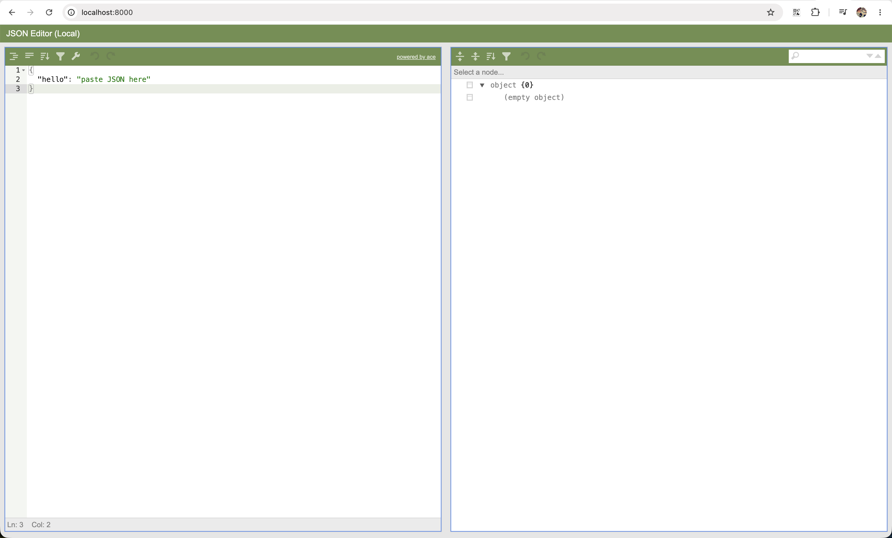

# Local JSON Editor

A single-page JSON formatter/editor that runs entirely in your browser. No build step, no
dependencies to install, no backend, no server — just open `index.html`.

Left pane: raw JSON code (Ace editor). Right pane: the same document as a JSONEditor tree.
Type or paste JSON on the left and the tree on the right updates live; invalid JSON while you
type is simply ignored.



## Files

| File | Purpose |
| --- | --- |
| `index.html` | The whole app (HTML + CSS + JS). |
| `vendor/` | JSONEditor 10.4.3 (JS, CSS, icon sprite), bundled so the app works offline. |
| `Dockerfile` | `nginx:alpine` serving `index.html` + `vendor/` |
| `scripts/build.sh` | Builds the Docker image |

The editor library is bundled in `vendor/`, so no internet connection is needed.
Everything you paste stays in your own browser tab — there is no server-side processing.

## Run it

Open `index.html` directly in your browser:

```bash
open index.html          # macOS
# xdg-open index.html    # Linux
# start index.html       # Windows
```

Or just double-click the file in Finder/Explorer. `file://` is fully supported: nothing is
fetched over the network and no ES modules are used, so the browser does not block anything.

Keep the `vendor/` folder next to `index.html`; without it the page shows a one-line error.

## Optional: serve over HTTP instead

Opening the file works fine. If you prefer a local URL:

```bash
python3 -m http.server 8000
```

Then open <http://localhost:8000>. Any static server works (`npx serve`, `php -S`, …).

## Run with Docker

Build:

```bash
docker build -t jsoneditor:latest .
```

or use the helper script:

```bash
./scripts/build.sh
# IMAGE_NAME=myeditor IMAGE_TAG=dev ./scripts/build.sh
```

Run:

```bash
docker run -d -p 8080:80 --name jsoneditor jsoneditor:latest
```

Then open <http://localhost:8080>.

Stop and remove:

```bash
docker rm -f jsoneditor
```
